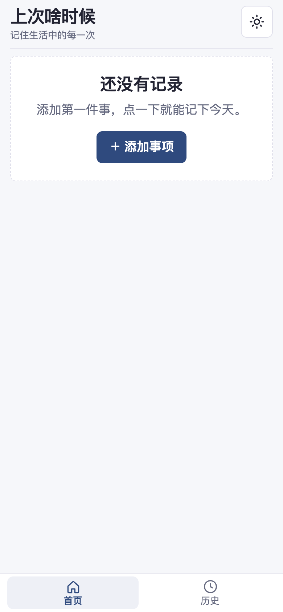
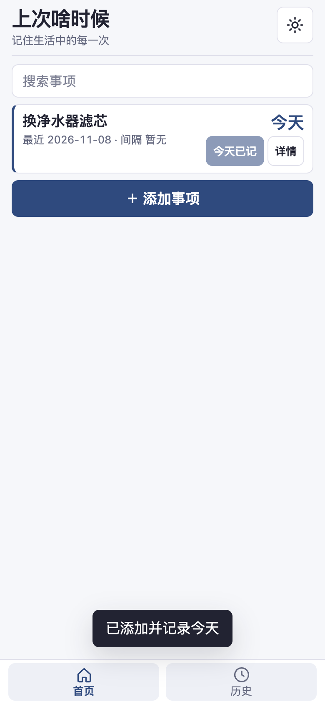
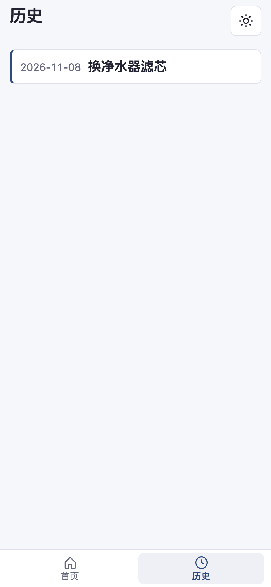

# Last Time · WhenLast

[简体中文](./README.md) ｜ English

Changing the water filter, getting a haircut, servicing the car… for things that have no fixed schedule, this tells you at a glance when you last did it and how many days ago — one tap records today.

<div align="center">
  
  
  
</div>

> Screenshots come from the real running 0.1.2 build (390×844 phone viewport, light theme, one sample item).

A local-first "when did I last do this" tracker. Open it and every item shows how many days have passed; one tap logs a new record and the history stays reviewable.

## What it is for

Plenty of things in life have no fixed cycle, yet you still want to know "when was the last time": replacing a filter, a haircut, car maintenance, watering plants, tidying up backups. WhenLast keeps these items together and counts intervals in calendar days, with all data staying in your own browser.

## Core features

- **Items**: add, rename and delete items.
- **Log once**: one tap records today and immediately shows the interval.
- **Backfill**: add records for past dates; intervals are recalculated.
- **History**: see the timeline of one item and the gap between the latest two records.
- **Calendar-day intervals**: counted in natural days, unaffected by the time of day.
- **Search**: filter items by name.
- **JSON backup**: export everything as JSON and import from a backup file.
- **Offline**: once installed as a PWA it keeps working without a network.
- **Themes**: light / dark / follow system.
- **Languages**: Simplified Chinese / English.

## Tech stack

- Vite + TypeScript
- Native IndexedDB (no third-party storage layer)
- Service Worker (offline cache)
- Capacitor 8 (Android native shell)

## Where to open it

- **Web / add to home screen**: <https://wanghoufan.github.io/p067-last-time-when/> — open it in a phone browser and choose "add to home screen" to launch it as a PWA (the shortcut name carries a `.pwa` suffix so it is easy to tell apart from the native app).
- **Android app**: `android/` is a Capacitor 8 native shell; build it locally with the Android SDK (only a local debug build exists so far, no signed release). The shell handles layered back-button behaviour, safe areas, system theme following, and native export / import.

## Quick Start (run locally)

```bash
npm install
npm run dev
```

Other common commands:

```bash
npm run build    # type check + build + generate the Service Worker
npm run preview  # preview the build output
```

## Tests

```bash
npm test         # unit tests
npm run build    # build (prerequisite for E2E)
npm run qa:e2e   # browser E2E
```

## Data and privacy

- All data lives only in the current browser's IndexedDB; nothing is uploaded to a server.
- No backend, no account, no cloud sync, and no usage data collected.
- Clearing browser site data loses the records — export a JSON backup regularly and keep it safe.
- Migrate between browsers or devices by exporting / importing JSON.

## Layout

```text
src/       application code (domain logic, storage, UI, i18n, PWA registration)
tests/     unit tests
scripts/   Service Worker build, E2E tests, icon generation
public/    manifest, Service Worker template, icons
```

## Version

0.1.2 (Capacitor 8 Android shell, ink-blue palette and compact list)
