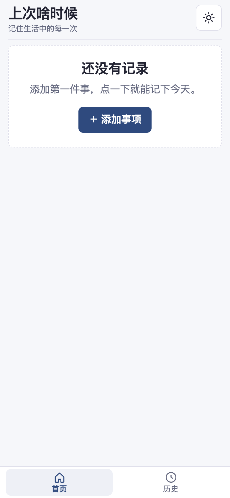
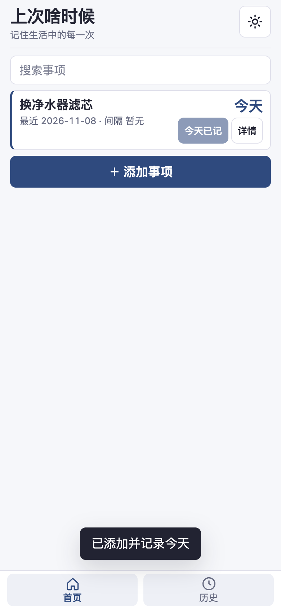
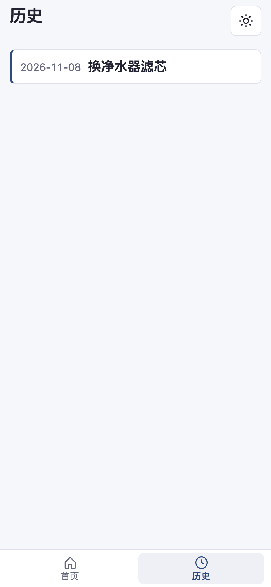

# 上次啥时候 · WhenLast

[English](./README.en.md) ｜ 简体中文

换滤芯、理发、给车做保养……这些没固定周期的事，打开就知道「上次是哪天、已经隔了几天」，点一下就能记下今天。

<div align="center">
  
  
  
</div>

> 截图取自 0.1.2 构建产物的真实运行画面（iPhone 尺寸 390×844，浅色主题，示例数据一条）。

本地优先的「上次做某事是什么时候」记录工具。打开就看到每件事距今天数，一键记一次，历史可回看。

## 产品定位

生活里有很多事没有固定周期，却总想知道「上次是什么时候」：换滤芯、理发、给车做保养、浇花、整理备份。WhenLast 把这类事项集中记录，用日历日计算间隔，数据只留在你自己的浏览器里。

## 核心功能

- **事项**：添加、重命名、删除事项。
- **记一次**：一键记录今天做过，立即显示距今天数。
- **补记**：为历史日期补录记录，间隔自动重算。
- **历史**：查看某事项的记录时间线，以及最近两次之间的间隔。
- **日历日间隔**：按自然日计算天数，不受具体时刻影响。
- **搜索**：按名称快速筛选事项。
- **JSON 备份**：导出全部记录为 JSON，也可从备份文件导入。
- **离线**：作为 PWA 安装到桌面后，断网仍可使用。
- **主题**：浅色 / 深色 / 跟随系统三档。
- **多语言**：简体中文 / English。

## 技术栈

- Vite + TypeScript
- 原生 IndexedDB（无第三方存储层）
- Service Worker（离线缓存）
- Capacitor 8（安卓原生壳）

## 打开方式

- **网页版 / 添加到桌面**：<https://wanghoufan.github.io/p067-last-time-when/> ，用手机浏览器打开后「添加到桌面」即可以 PWA 方式启动（快捷方式名带 `.pwa` 后缀，便于和原生 App 区分）。
- **安卓 App**：`android/` 是 Capacitor 8 原生壳工程，需本机 Android SDK 自行构建（当前只有本地 debug 包，尚未发布正式签名包）；壳内已处理返回键分层、安全区、系统主题跟随、原生导出 / 导入。

## 本地运行

```bash
npm install
npm run dev
```

其他常用命令：

```bash
npm run build    # 类型检查 + 构建 + 生成 Service Worker
npm run preview  # 预览构建产物
```

## 测试

```bash
npm test         # 单元测试
npm run build    # 构建（E2E 前置步骤）
npm run qa:e2e   # 浏览器端 E2E
```

## 数据与隐私

- 所有数据只保存在当前浏览器的 IndexedDB 中，不上传任何服务器。
- 无后端、无账号、无云同步，也不收集任何使用数据。
- 清除浏览器站点数据会丢失记录，请定期导出 JSON 备份并自行妥善保管。
- 换浏览器或换设备时，通过导出 / 导入 JSON 迁移数据。

## 目录结构

```text
src/      应用源码（领域逻辑、存储、界面、多语言、PWA 注册）
tests/    单元测试
scripts/  构建 Service Worker、E2E 测试、图标生成
public/   清单文件、Service Worker 模板、图标
```

## 版本

0.1.2（含 Capacitor 8 安卓壳、墨蓝配色与紧凑列表）
